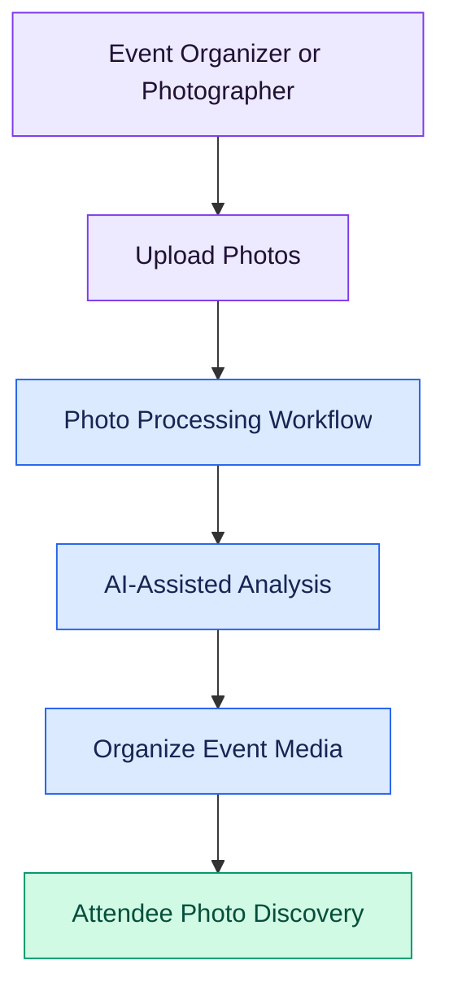

# FhotoxAI — AI-Powered Event Photo Discovery

<p align="center">
  <strong>Every moment, found by the people who were there.</strong>
</p>

<p align="center">
  An AI-powered event photo platform designed to help attendees discover their photos and make event memories easier to find, organize, and share.
</p>

<p align="center">
  
</p>

<p align="center">
  
  
  
  
</p>

---

## Overview

FhotoxAI is an event photo discovery platform that aims to simplify how event photographs are collected, processed, and accessed.

At large events, photographs are often distributed across multiple albums, making it difficult for attendees to find images featuring them. FhotoxAI addresses this discovery problem through an event-focused workflow and AI-assisted photo processing.

The goal is to make event photography more accessible for attendees while providing organizers and photographers with a streamlined digital workspace.

## Key Features

### AI-Assisted Photo Discovery
- Designed to help attendees locate relevant event photographs.
- Supports an event-centered photo discovery workflow.
- Provides a foundation for AI-based image analysis and photo organization.

### Event Management
- Dedicated workflows for event organizers.
- Event-focused photo organization and management.
- Interfaces for managing event-related content.

### Photographer Workspace
- A dedicated interface for photographers.
- Access to event-related photography workflows.
- A foundation for managing and processing photographic content.

### Attendee Experience
- A redesigned landing page and dashboard experience.
- Event-oriented photo discovery.
- A streamlined interface for accessing event photographs.

### Modern User Interface
- Redesigned navigation and page layouts.
- Reusable workspace components.
- Responsive styling and visual improvements.
- Dedicated styling for landing pages and dashboards.

### Backend and Infrastructure
- API-based communication between frontend and backend.
- Docker-based development and service orchestration.

> **Note:** Face matching, automated identification, background processing, and other AI capabilities depend on the implementation and configuration available in the current version. Verify each feature before describing it as production-ready.

## How It Works



The diagram represents the intended workflow. The exact processing sequence depends on the application's implemented services and configuration.

## Technology Stack

| Component | Technology |
|---|---|
| Frontend | React |
| Frontend build tool | Vite |
| Frontend styling | CSS and modular stylesheets |
| Backend API | Python and FastAPI |
| API routing | FastAPI routers |
| Containerization | Docker and Docker Compose |
| Database | PostgreSQL (schema in `backend/commons/schema.sql`) |

Additional libraries and services should be documented according to the dependencies and configuration actually present in the repository.

## Project Structure

```text
fhotoxai/
├── backend/
│   ├── general_api/
│   │   ├── routers/
│   │   │   └── photos.py
│   │   ├── services/
│   │   ├── Dockerfile
│   │   └── main.py
│   ├── scripts/
│   └── .env.example
├── docs/
├── frontend/
│   ├── public/
│   └── src/
│       ├── assets/
│       ├── components/
│       ├── pages/
│       ├── styles/
│       ├── utils/
│       ├── App.jsx
│       └── main.jsx
├── docker-compose.yml
└── README.md
```

*This tree highlights the principal areas relevant to the current feature work; it is not intended to list every repository file.*

## Getting Started

### Prerequisites

Install the following tools before running the project:

- [Git](https://git-scm.com/downloads)
- [Docker Desktop](https://www.docker.com/products/docker-desktop/)
- Docker Compose, included with current Docker Desktop releases

For local development without containers, install the compatible Node.js and Python versions specified by the project configuration.

### 1. Clone the repository

```bash
git clone https://github.com/vaibhavburad15/fhotoxai.git
cd fhotoxai
```

### 2. Configure environment variables

Review the example configuration:

```bash
```

For Windows Command Prompt:

```bat
type backend\.env.example
```

Create the required environment configuration using the variable names documented in the project. If the application expects a `backend/.env` file, create it from the example:

```bat
copy backend\.env.example backend\.env
```

Update the values locally. Do not commit real credentials, API keys, database passwords, or private configuration files.

### 3. Start the application

Inspect the Compose configuration and available services first:

```bash
docker compose config --services
```

Then start the configured application services:

```bash
docker compose up --build -d
```

If the project requires a development override, follow the repository's documented development command and confirm which Compose files it uses.

### 4. Check service status

```bash
docker compose ps
docker compose logs --tail=100
```

Use the actual ports and health-check URLs defined in the Compose configuration to verify that the frontend and backend are running.

### 5. Stop the application

```bash
docker compose down
```

This stops and removes the Compose containers and network. Persistent volumes are normally retained unless explicitly removed.

## Testing

Before submitting changes or deploying the application, verify the following:

- [ ] The frontend builds and starts successfully.
- [ ] The backend starts and its health checks pass.
- [ ] Existing photo upload and discovery workflows remain functional.
- [ ] Invalid files and unsupported formats are handled safely.
- [ ] Processing errors are logged and handled appropriately.
- [ ] No secrets or private user data are included in the repository.

Run the test commands documented in the project configuration. For example, inspect the available backend tests and frontend scripts before selecting the appropriate commands.

## Security and Privacy

Media applications may handle personal photographs. The implementation should:

- Validate file types and file sizes.
- Avoid exposing uploaded media without authorization.
- Keep credentials in environment variables or a secret manager.
- Restrict access to event and user data.
- Handle temporary files appropriately.
- Apply suitable upload, storage, and retention policies.
- Avoid logging sensitive media data or credentials.

These are security goals and should not be interpreted as confirmation that every control is already implemented.

## Contributing

Contributions, bug reports, and improvement suggestions are welcome, subject to the repository owner's contribution guidelines.

1. Fork the repository.
2. Create a feature branch.

   ```bash
   git checkout -b feat/your-feature
   ```

3. Implement your changes and add relevant tests.
4. Verify the application and review your changes.
5. Commit your work.

   ```bash
   git add -A
   git commit -m "Describe your changes"
   ```

6. Push the branch to your fork.

   ```bash
   git push -u origin feat/your-feature
   ```

7. Open a Pull Request against the original repository's intended base branch and explain the changes and testing performed.

Do not include secrets, local environment files, generated media, or unrelated changes in a contribution.

## Roadmap

Potential areas for future development include:

- Progress tracking for long-running jobs.
- Better photo organization and search.
- Improved accessibility and mobile usability.
- Expanded automated testing and error reporting.
- Additional privacy and media-retention controls.

These are potential improvements, not commitments to specific release dates.

## Documentation

- [System Architecture](docs/system_architecture.md)
- [GitHub Repository](https://github.com/vaibhavburad15/fhotoxai)

## License

Check the repository for its existing license and distribution terms. If no license has been added, contact the repository owner before selecting or claiming an open-source license.

---

<p align="center">
  <strong>FhotoxAI — Making event memories easier to discover.</strong>
</p>
